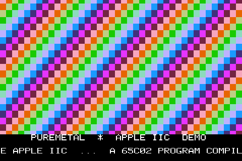
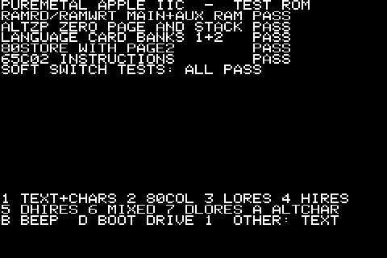
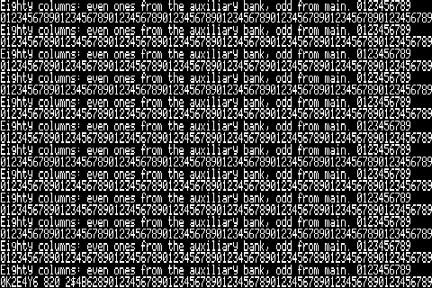
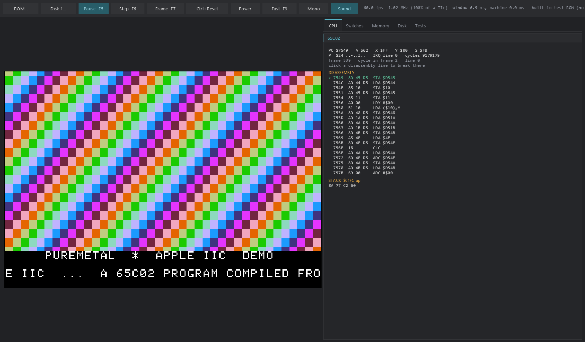

# Apple IIc for the Raspberry Pi Pico series

An Apple IIc emulator for the Raspberry Pi Pico W (RP2040) and Pico 2 W (RP2350), written in PureMetal and
compiled with PureMetalForge to bare-metal machine code - no SDK, no RTOS. The 65C02 runs on one core at the
IIc's own 59.92 frames a second; the other core draws the picture on a 480 x 320 SPI panel at the same rate
and keeps the Bluetooth radio going. The same machine also runs as a Windows desktop program with debug
panes, built from the same source files.




**No Apple code is included.** The IIc ROM and its character generator are Apple's, and disk images belong
to their publishers. You supply your own ROM and disks (see [ROMs and disks](#roms-and-disks)). Without a
ROM the emulator runs this project's own **test ROM**, which checks the memory switches, shows every video
mode and boots a disk; the character set is this project's own. The bundled demo disk holds only a program
written in PureMetal.

## Features

- **65C02** - the Rockwell R65C02 of the IIc: every CMOS instruction and addressing mode, BBR/BBS/RMB/SMB,
  the undefined opcodes as the silicon's NOPs, decimal mode, cycle counts. Generated for both builds from
  one opcode table (`tools/gen_cpu.py`).
- **128 KB** - main and auxiliary banks, 80STORE, RAMRD/RAMWRT, ALTZP, the language card (both $D000
  banks, pre-write), the IIc's two ROM banks (32 KB ROMs).
- **Video** - 40/80-column text with inverse, flashing, lower case and MouseText; lo-res, double lo-res,
  hi-res, double hi-res, mixed; page 2. NTSC artifact colour computed from the dot stream (one rule gives
  hi-res violet/green/blue/orange and the 16 double hi-res colours); a monochrome switch.
- **The built-in drive** - the IWM in Disk II mode, two drives: `.DSK`/`.DO`, `.PO` and `.NIB` on the
  Picos, plus `.WOZ` 1/2 on the desktop. On a Pico the disk is in the firmware image, packed a track at a
  time.
- **Keyboard** (latch, strobe, any-key-down, Open-Apple and Solid-Apple), **VBL** ($C019 and the VBL
  interrupt), **speaker** ($C030) sampled at 48 kHz against machine time.
- **Both cores working** - core 0 runs the machine; core 1 draws each finished frame, only the columns
  that changed, and streams them to the panel by DMA while it draws the next line. Each core's busy share
  is in the firmware's status line.
- **Thumb-2 on the RP2350** - every 65C02 instruction's dispatch and its first operand fetch, and the
  panel's hi-res drawing, are Cortex-M33 (Thumb-2) assembly; the RP2040 uses Cortex-M0+ (Thumb-1) where
  it measured faster. Each is checked against plain PureMetal on silicon.
- **Sound** on a Bluetooth speaker in a build that names one; on the desktop, through the PC's sound.
- **Desktop version** for Windows - the same machine files, drawn with the
  [Neon Arcade Display Engine](https://github.com/ajtaji/Neon-Arcade-Dispay-Engine): ROM and disk pickers,
  CPU (with disassembly and breakpoints), switches, memory, disk and test panes, single step, full speed.

Not emulated: the serial ports (they answer "nothing received"), the mouse, the memory expansion card.

## Supported boards

| Board | Firmware | Panel | Tested on silicon |
|---|---|---|---|
| Raspberry Pi Pico W (RP2040, 200 MHz) | `firmware/apple2c-pico-w.uf2` | LAFVIN ST7796, SPI 100 MHz | yes |
| Raspberry Pi Pico 2 W (RP2350, 150 MHz) | `firmware/apple2c-pico2-w.uf2` | LAFVIN ST7796, SPI 75 MHz | yes |

The panel is the LAFVIN ST7796 3.5" kit (480 x 320):

| Signal | Pin |
|---|---|
| LCD SCK / MOSI | GP2 / GP3 (SPI0) |
| LCD CS / DC / RESET | GP5 / GP6 / GP7 |

The IIc's 560 x 192 picture is shown 6:7 across (a 40-column character is 12 pixels: its six lit dot
columns, each two pixels wide) and 5:3 down. The SPI clock is at most half the system clock: 100 MHz on a
Pico W at 200 MHz, 75 MHz on a Pico 2 W at its standard 150 MHz.

## Performance

Measured on the boards with the firmware's own status line, PureMetalForge 341fd5aca:

| | Pico W | Pico 2 W |
|---|---:|---:|
| The machine, paced to a real IIc | 59.92 frames/s, 1.02 MHz | 59.92 frames/s, 1.02 MHz |
| The panel, the PureMetal demo (a lo-res page swap every few frames) | **60 frames/s**, none missed | **60 frames/s**, none missed |
| Core 0 / core 1 busy, the demo | 14% / 21% | 11% / 26% |
| Core 0 / core 1 busy, an Applesoft game at its title (IIc ROM 4) | 12% / 4% | 10% / 4% |
| The longest panel update (a whole page swap, 168 lines) | 24.5 ms | 32.4 ms |
| A whole screen drawn: hi-res / double hi-res / 40-column text / lo-res | 14.1 / 14.1 / 10.4 / 6.7 ms | 12.8 / 12.8 / 11.1 / 7.1 ms |
| The same through the plain PureMetal renderer | 66.8 / 74.6 / 35.9 / 46.6 ms | 68.3 / 76.1 / 38.9 / 36.8 ms |
| 65C02 alone, Klaus Dormann's 65C02 / 6502 tests | 7.3 / 6.7 MHz | 8.38 / 7.39 MHz |
| The whole machine unthrottled, a disk being read | 4.6-5.8 MHz | 4.2-6.3 MHz |

On the Pico 2 W the Thumb-2 operand fetch alone took the 65C02 from 7465 to 8381 kHz (+12.3%) and from 6680
to 7393 kHz (+10.7%) on the same two tests, with identical cycle counts. Before the panel was reworked
(free-running passes, a row at a time), the demo reached the panel 13.6 times a second at most.

The desktop version runs the machine at 60.0 frames a second; its 65C02 core alone runs 175 million
instructions a second (Klaus Dormann's 6502 functional test, 30,646,176 instructions).

## Quick start

1. Hold BOOTSEL while plugging in the Pico, then copy `firmware/apple2c-pico-w.uf2` (Pico W) or
   `firmware/apple2c-pico2-w.uf2` (Pico 2 W) to the drive that appears.
2. The panel shows the test ROM: its memory checks, then a menu.
3. Type on the IIc from the PC (Python 3 with `pyserial`: `py -3 -m pip install pyserial`):

   ```
   py -3 tools/console.py --port COM7
   ```

   The test ROM's keys: `1` text and the character set, `2` 80 columns, `3` lo-res, `4` hi-res,
   `5` double hi-res, `6` mixed, `7` double lo-res, `A` the alternate character set, `B` a beep,
   `D` boot drive 1.
4. The PureMetal demo (a lo-res rainbow, a scroller and Ode to Joy on the speaker) is a disk you build with
   PureMetalForge's Apple IIc board; see [Building from source](#building-from-source).




## ROMs and disks

The emulator needs nothing but this repository to run the test ROM and the demo. For Apple's own firmware
(Applesoft, the IIc's monitor, booting DOS and ProDOS disks):

- **The ROM** - dump the ROM chip of an Apple IIc you own (16 KB for the original ROM 255, 32 KB for
  ROM 0, 3 and 4; tested with ROM 4, part 341-0445-B), or obtain it from a licensed source.
- **Disks** - images of disks you own (`.dsk`, `.do`, `.po`, `.nib`; `.woz` on the desktop), or software
  whose authors distribute it freely.

On a Pico, the ROM and one disk go into a private firmware image built on your PC. Everything it writes is
in `private/`, which git ignores:

```
py -3 tools/make_private.py --rom <your IIc ROM> --disk <a disk image> --no-sound
tools/board.ps1 -Source private/apple2c.picow -Output private/apple2c.uf2 -Port COM7
```

`private/apple2c.pico2w` is the Pico 2 W's. For sound on a Bluetooth speaker, leave out `--no-sound` and give
`--speaker-from <file>`: a PureMetal file with your speaker's address under a `PackBluetoothPeer:` label
(six bytes, least significant first). The address is copied into `private/` and never printed.

With the IIc ROM the machine starts like a real IIc ("Apple //c", the beep, the drive spinning);
Ctrl+Reset (monitor `r`) gives Applesoft. DOS 3.3 disks boot and run.

## Using the Pico build

`tools/console.py` sends the PC's keys to the IIc: Return, Backspace and the arrows, Esc, Tab and Delete
are mapped, Ctrl+letter is the control key, and Applesoft wants capitals (Caps Lock), as on a real IIc.
Ctrl+Q quits.

Ctrl+] then a letter is a firmware monitor command:

| Key | Command |
|---|---|
| `s` | status line: frames, CPU kHz, each core's busy share, panel passes and missed frames, disk, sound |
| `t` | the screen as text |
| `c` | capture the panel's picture (`tools/board.py` saves it as a PNG) |
| `p` | CPU registers and the soft switches |
| `f` | full speed on/off |
| `m` | monochrome on/off |
| `r` / `R` | Ctrl+Reset / power off and on |
| `d` / `k` | disk / keyboard state |
| `o` / `a` | hold Open-Apple / Solid-Apple for the next key |
| `x` | check the panel's drawing against the reference renderer, pixel for pixel |
| `v` | the periodic status lines on/off |

## Building from source

You need **PureMetalForge 341fd5aca or later** (the PureMetal compiler) and Python 3. `tools/board.ps1`
builds, checks that the image ends below flash offset $40000, uploads it with PureMetalForge's own uploader
and reads the board's serial output or runs a test script. Name the compiler with `-Compiler`, the
`PUREMETALFORGE` environment variable, or one line `$LocalCompiler = '<path>'` in `tools/board.local.ps1`.

```
# the public firmware
tools/board.ps1 -CompileOnly -Source rp2040/apple2c.picow -Output firmware/apple2c-pico-w.uf2
tools/board.ps1 -CompileOnly -Source rp2350/apple2c.pico2w -Output firmware/apple2c-pico2-w.uf2

# build, upload and run a test script on a board
tools/board.ps1 -Port COM7 -Source rp2040/apple2c.picow -Output build/apple2c.uf2 -Script tests/testrom.txt -ScriptSeconds 90
```

The PureMetal demo is `demo/apple2c_demo.apple2c` (generated by `demo/make_demo.py`). PureMetalForge's
Apple IIc board compiles it into a disk, `demo/apple2c_demo.dsk`, that boots through the IIc firmware's
sector read at $C65C; the test ROM provides that entry point (and WAIT at $FCA8) from its own code, so the
disk boots without Apple's ROM. The demo machine (`*/Diagnostics/demo.*`) includes the disk as
`build/demo_disk.pmi`:

```
py -3 demo/make_demo.py
PureMetalForge --compile demo/apple2c_demo.apple2c -o demo/apple2c_demo.hex
py -3 tools/pack_disk.py demo/apple2c_demo.dsk build/demo_disk.pmi
```

Generated sources, all reproducible: `tools/gen_cpu.py` (the 65C02 core for both builds),
`tools/make_testrom.py` (the test ROM, with its own 65C02 assembler `tools/asm65.py`), `tools/make_font.py`
(the character set), `tools/make_testdisk.py` (the test disk), `tools/make_vectors.py` and
`tools/embed_tests.py` (the CPU test data, see [Testing](#testing)).

### How it works

- The CPU core is generated PureMetal, run from SRAM: 256 handlers reached through a dispatch table, the
  65C02's registers held in Arm registers for the whole program (`ReserveRegister`), memory through
  512-entry page tables. On the Pico 2 series each handler ends in a ten-instruction Thumb-2 tail (the
  cycle count, the next opcode from the page table, `ldr pc` from the dispatch table) that also leaves the
  opcode's page in a register, so the handler's operand is one `ldrb.w` - or one unaligned `ldrh.w` for a
  16-bit address.
- The panel: each line keeps a copy of the bytes it showed; core 1 compares the screen with it 4 bytes at
  a time and draws only the columns that changed (one more each side in hi-res, where the artifact colour
  reads the neighbouring dots). The SPI stays 16 bits wide for the whole pass: a command goes as one
  16-bit word whose high byte is the ST7796's NOP. Text and lo-res are drawn straight to pixels; hi-res and
  double hi-res in assembly (dots from a table, the colour four dots a pass with `bfi` on the M33, the
  pixel map with scaled-index loads).

## The desktop version

Clone the [Neon Arcade Display Engine](https://github.com/ajtaji/Neon-Arcade-Dispay-Engine) beside this
repository, then build with PureBasic 6 (C back end, x64) from PowerShell:

```
& "C:\Program Files\PureBasic\Compilers\pbcompilerc.exe" desktop\apple2c_desktop.pb /EXE desktop\PureMetalAppleIIc.exe /THREAD /DPIAWARE /OPTIMIZER
& "C:\Program Files\PureBasic\Compilers\pbcompilerc.exe" desktop\apple2c_check.pb /CONSOLE /OPTIMIZER /EXE desktop\apple2c_check.exe
& "C:\Program Files\PureBasic\Compilers\pbcompilerc.exe" desktop\cpu_check.pb /CONSOLE /OPTIMIZER /EXE desktop\apple2c_cpu_check.exe
```

(An engine elsewhere: add `/CONSTANT GL_ENGINE_DIR$=<path>/`; the trailing slash matters.)

```
desktop\PureMetalAppleIIc.exe --disk1 demo\apple2c_demo.dsk --type D
desktop\PureMetalAppleIIc.exe --rom <your IIc ROM> --disk1 <a disk image>
```

Options: `--rom file`, `--disk1 file`, `--disk2 file`, `--mono`, `--mute`, `--type TEXT` (typed after start),
`--shot file.png --seconds N` (saves the window and closes). Without `--rom` the test ROM runs.

Keys: typing goes to the IIc; Left Alt / Right Alt are Open-Apple / Solid-Apple; Ctrl+F12 is Ctrl+Reset,
Ctrl+Alt+F12 a cold start; F5 run/pause, F6 step one instruction, F7 one frame, F9 full speed, F11 full
screen. Click a disassembly line to break there.



`desktop\apple2c_check.exe` runs the machine without a window:
`--rom file --disk1 file --frames N --type-at FRAME TEXT --expect TEXT --png file --span-check`.

## Testing

| Where | What | Command |
|---|---|---|
| PC | 87,053 single-instruction vectors, Klaus Dormann's 65C02 and 6502 tests | `desktop\apple2c_cpu_check.exe` |
| Pico W, Pico 2 W | 3,072 vectors and both Klaus tests on silicon | `tools/board.ps1 -Port COM7 -Source rp2040/Diagnostics/cpu_verify.picow -Output build/cpu_verify.uf2 -Seconds 90` |
| PC | the test ROM's memory checks | `apple2c_check.exe --frames 60 --expect "ALL PASS"` |
| PC | the test disk: boot, all 544 sectors of tracks 1-34 | `apple2c_check.exe --disk1 build\testdisk.dsk --frames 4000 --type-at 30 D --expect "544 SECTORS PASS"` |
| PC | every column span of every line drawn alone equals the whole line | `apple2c_check.exe --frames 400 --type-at 200 4 --span-check` |
| Pico W, Pico 2 W | the test ROM, every mode captured | `tests/testrom.txt` with `*/apple2c.*` |
| Pico W, Pico 2 W | the test disk | `tests/diskboot.txt` with `*/Diagnostics/disk_boot.*` |
| Pico W, Pico 2 W | the panel's pixels against the reference renderer in every mode (`x`) | `tests/panelcheck.txt` with `*/Diagnostics/demo.*` |
| Pico W, Pico 2 W | the panel's frame rate and each core's share; the machine unthrottled | `tests/panel.txt` with `*/Diagnostics/demo.*`; `tests/machine_speed.txt` with `*/Diagnostics/disk_boot.*` |
| Pico W, Pico 2 W | the PureMetal demo and its sound | `tests/demo.txt` with `*/Diagnostics/demo.*` |

All of these pass on both boards (2026-10-25).

The CPU test data is built, not stored. `tools/fetch_tests.py` downloads the inputs, pinned to a commit:
[SingleStepTests/65x02](https://github.com/SingleStepTests/65x02) (MIT; the `rockwell65c02` set) into
`build/ss`, and [Klaus Dormann's 6502/65C02 functional tests](https://github.com/Klaus2m5/6502_65C02_functional_tests)
(GPLv3) into `Diagnostics/`. Then `tools/make_vectors.py` writes `Diagnostics/vectors_full.bin` (included:
generated from the MIT vectors) and `tools/embed_tests.py` writes `Diagnostics/test_data.pmi` for the
board check. Klaus Dormann's tests are not part of this repository; firmware built with them is a
diagnostic, not the emulator.

## Known limits

- One disk on a Pico, read-only: it is in the firmware image, and a sector the program writes is counted
  and dropped (DOS reports success; the change is gone when the head leaves the track).
- The Pico's keyboard is the PC's, over USB serial; there is no keyboard connected to the board itself.
- The panel shows 6 of every 7 dots across (no line or colour disappears; single-dot details can).
- No serial ports, mouse or memory expansion card; no RGB (AppleColor) output - the colour is composite.
- A full-screen change (a whole page swap) takes 24-33 ms to reach the panel; a frame that changes the
  whole screen every 1/60 s is shown at about 30-40 frames a second.

## Repository layout

```
src/        the machine: 65C02 core (generated), memory and switches, video, disk, sound, the panel
rp2040/     the Pico W build and its diagnostics (CPU check, test disk, demo)
rp2350/     the Pico 2 W build and its diagnostics
desktop/    the Windows program, the headless checker, the CPU check
demo/       the PureMetal demo: its generator and source
firmware/   ROM-free firmware images (SHA256SUMS.txt)
tests/      scripts for tools/board.py, run against a board
tools/      generators, the test-data tools, build/upload, the serial console
Diagnostics/  CPU test vectors (generated) and the board check's source
docs/       screenshots (the firmware's own captures and the desktop window)
licenses/   third-party licences
```

## Licence and credits

MIT (see `LICENSE`). Third-party material keeps its own licence:

- SingleStepTests/65x02 (MIT, `licenses/SingleStepTests-65x02-MIT.txt`): the single-instruction vectors in
  `Diagnostics/vectors_full.bin` are generated from it.
- Klaus Dormann's 6502/65C02 functional tests (GPLv3): fetched by `tools/fetch_tests.py`, not included.

Read for the hardware's behaviour, not copied: the Apple IIc and IIe Technical Reference Manuals,
"Beneath Apple DOS", MAME's apple2e.cpp and CiderPress's Nibble.cpp.

Apple, Apple IIc and Applesoft are trademarks of Apple Inc. This project is not affiliated with Apple.
